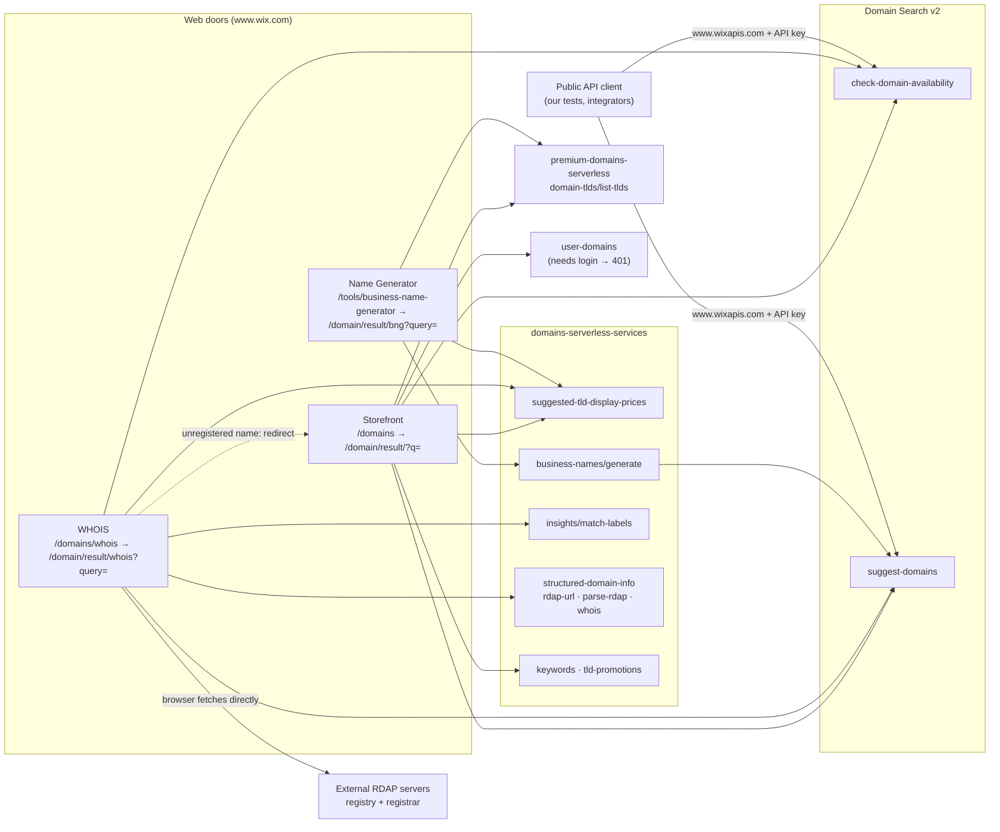

# Architecture: the four doors to "Can I get this name?"

How each door is built, which calls it makes, and what each call drives on screen.
Mapped on 2026-11-04 from the browser's network and console (logged out, from Israel), plus the public API docs.
Everything here was observed unless marked *not verified*.

## 1. The big picture

**In one sentence:** all three web doors answer "is it available?" with the **same Domain Search v2 endpoints**
that the public API exposes. They differ in what they add around that answer (prices, WHOIS records, AI names).

## 2. What the doors are made of

| Layer | What we saw |
|---|---|
| **Landing pages** (`/domains`, `/domains/whois`, `/tools/business-name-generator`) | Wix marketing pages rendered by the Wix site renderer (*Thunderbolt* bundles in `_partials/wix-thunderbolt`). Their only job is to collect input and hand off through a URL. |
| **Results pages** (`/domain/result/…`) | A separate front-end app, `domains-static-external-pages` (version `1.1936.0`), loaded from `static.parastorage.com` (e.g. `anonymous-gate-page.umd.min.js`, `whois-results-page.umd.min.js`). This app calls the backends below. |
| **Backends** | Same-origin `www.wix.com` paths: `domain-search/v2/*` (the public API, proxied), `_serverless/*` (prices, names, WHOIS, labels), `_api/*` (header/footer, user domains, experiments). |
| **External** | Registry and registrar RDAP servers, called **from the browser** on the WHOIS door. |

**Handoff by URL:** each landing page only builds a results URL, so any result can be opened directly,
e.g. `https://www.wix.com/domain/result/?q=google.com`. The UI tests rely on this.

## 3. Door by door

### 3.1 Domain storefront
`/domains` → search → `/domain/result/?q=<input>`

| Call | Drives on screen |
|---|---|
| `GET domain-search/v2/check-domain-availability?domain=…` | The verdict: "Exact Match · Available now!" card, or "*name* is already registered" |
| `GET domain-search/v2/suggest-domains?query=…&paging.limit=10` | The alternatives list (hero/best-match cards + list) |
| `POST _serverless/…/suggested-tld-display-prices` | Every price on the cards: crossed-out `originalPrice`, shown `price`, and `renewalPrice` (tooltip only). Fetched once and reused for later searches. |
| `GET _serverless/premium-domains-serverless/domain-tlds/list-tlds` | The TLD catalogue Wix sells (rules per TLD: privacy, transfer, terms) |
| `GET _serverless/…/tld-promotions?limit=6` | TLD chips with descriptions (".com · Most popular…") |
| `GET _serverless/…/keywords?limit=8` | Returned `{"keywords":[]}` in every run, so its purpose is *not verified* |
| `GET _api/user-domains/v1/user_domains/<name>` | Whether *you* already own the name. Returns **401** when logged out, and the page ignores it. |
| `GET _api/wix-laboratory-server/…/conductExperiment?key=specs.funnel.newDomainDropdown` | A/B experiment flag (`false` in our runs) |
| `POST _serverless/…/display-prices` *(landing page)* | Prices on the landing page TLD chips |

**How the storefront routes input** (decided in the browser, before any call):

| Input | What happens |
|---|---|
| Name + supported TLD | `check-domain-availability` + `suggest-domains` + prices |
| No TLD (`sunnybaker`) | **No availability call**: suggestions only, top one labeled "Best Match" |
| TLD Wix doesn't sell (`.gov`) | Availability returns 400 `DOMAINS_UNSUPPORTED_TLD` → friendly message + link to supported TLDs |
| Non-Latin (`קפה.com`) | Converted to punycode (`xn--8db5ai.com`) for the availability call |
| Longer than 63 characters | Blocked in the browser; availability never called |
| Spaces / uppercase | Cleaned for the availability call only; sent raw to suggestions |

### 3.2 WHOIS lookup
`/domains/whois` → `/domain/result/whois?query=<domain>`

| Call | Drives on screen |
|---|---|
| `GET _serverless/…/structured-domain-info/rdap-url?domain=…` | Tells the browser which RDAP server to ask (e.g. `https://rdap.verisign.com/com/v1/`) |
| `GET https://rdap.verisign.com/…/domain/<name>` and the registrar's RDAP (e.g. `rdap.markmonitor.com`) | **Fetched directly by the browser**, not through Wix |
| `POST _serverless/…/structured-domain-info/parse-rdap` (×2: registry, registrar) | Turns raw RDAP into the structured record: Created / Updated / Expires, name servers, statuses, registrar, `registrant.redacted` |
| `GET _serverless/…/structured-domain-info/whois?domain=…&parse=false` | Raw WHOIS text for the "Raw Registry / Registrar WHOIS Data" sections |
| `check-domain-availability` + `suggest-domains?paging.limit=5` + prices | "*name* is registered. Explore some great alternatives below" + 5 alternatives |
| `POST _serverless/…/insights/match-labels` | Badges on the alternatives (`CREATIVE_EDGE` → "Creative & Memorable", `TRUSTED_AND_RELIABLE` → "Trusted & Reliable"…) |

**Unregistered domain:** WHOIS **redirects to the storefront** results page ("Available now!"), so this
door feeds the sales funnel. `check-domain-availability` is called twice on the way, once on each page.

### 3.3 Business Name Generator
`/tools/business-name-generator` → `/domain/result/bng?query=<description>`

| Call | Drives on screen |
|---|---|
| `POST _serverless/…/business-names/generate` | Step 1, "Choose a business name": 9 names, each with an AI-written `reasoning` (not shown on the card) |
| `GET domain-search/v2/suggest-domains?query=<chosen name>&paging.limit=10` | Step 2, "Claim the perfect domain for *name*": the domain list for the selected name |
| `POST …/suggested-tld-display-prices`, `GET …/list-tlds` | Prices and TLD rules, same as the storefront |

No `check-domain-availability` call: the generator trusts `suggest-domains` to return only available names.
Hebrew descriptions work; names come back in English.

### 3.4 Public Domain Search API
`https://www.wixapis.com/domain-search/v2/…`, account-level API key per the docs.

| Endpoint | Purpose |
|---|---|
| `GET check-domain-availability?domain=<name.tld>` | `available`, `premium`, `premiumType` |
| `GET suggest-domains?query=…&paging.limit=…&tlds=com` | Available suggestions + cursor paging |

The web doors call the **same paths** on `www.wix.com` (same request and response shape), without an API key.

## 4. How the doors relate

| Shared piece | Used by | Effect |
|---|---|---|
| `check-domain-availability` | Storefront, WHOIS, public API | **Single source of truth** for "available?", so the doors should never disagree (verified for `google.com`, `קפה.com`, random names) |
| `suggest-domains` | All four | Same suggestion engine; different `limit` per door (10 / 5 / API caller's choice). Generated, so results vary between calls. |
| Price service | Storefront, WHOIS, Generator | Same prices and the same card component on every door |
| Results app (`domains-static-external-pages`) | Storefront, WHOIS, Generator results | One front-end codebase, three page types |
| Redirect | WHOIS → Storefront | An unregistered name on WHOIS ends on the storefront |

**What this means for testing:**
- Testing `check-domain-availability` deeply covers the core answer of three doors at once. That's why the API is P0.
- A UI test only needs to prove each page **shows** that answer correctly (the UI-vs-API test).
- A change in the shared results app or price service can break every door together, so smoke-test all three.

## 5. Location and session effects
- Prices are in ₪ and `.co.il` is offered (often as "Best Match") because the visitor is in Israel. The tag-manager
  config returned `"geo":"IL"`.
- Dates on WHOIS follow the **browser language** (Hebrew dates on an English page in our runs).
- Logged-out visitors trigger `user-domains` 401s and cart errors in the console. The page ignores them.
